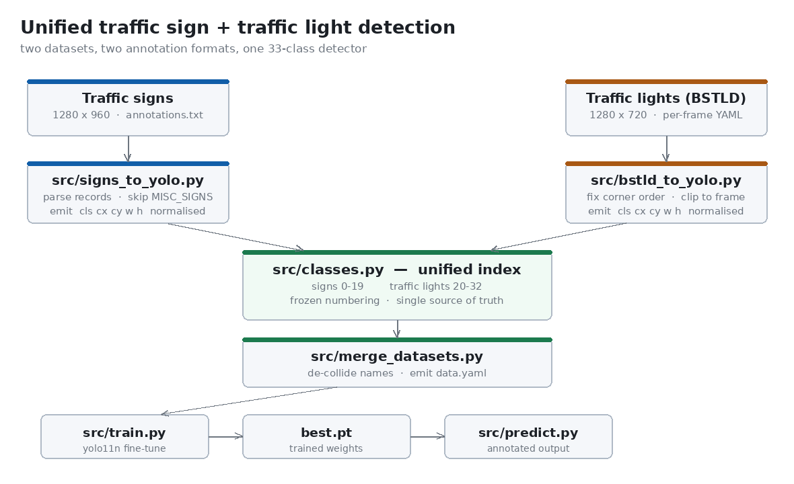
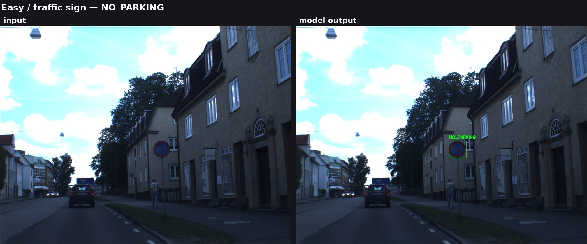
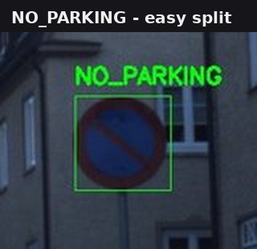
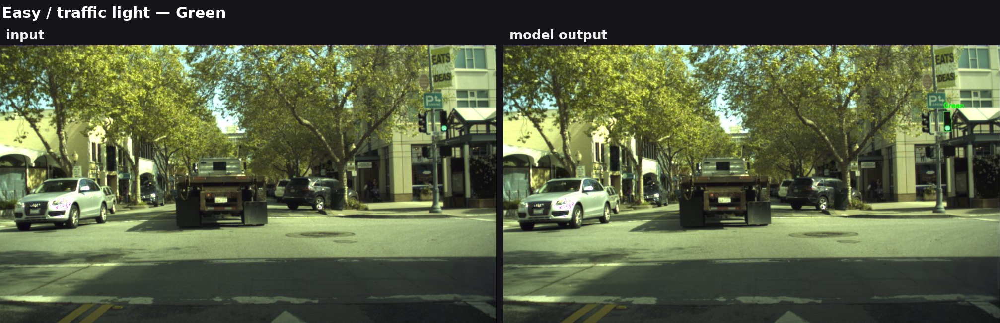
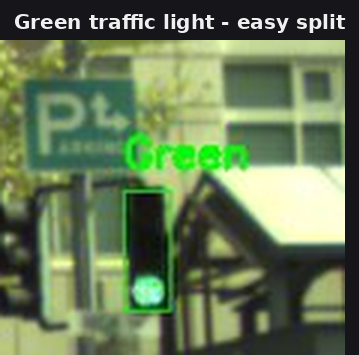
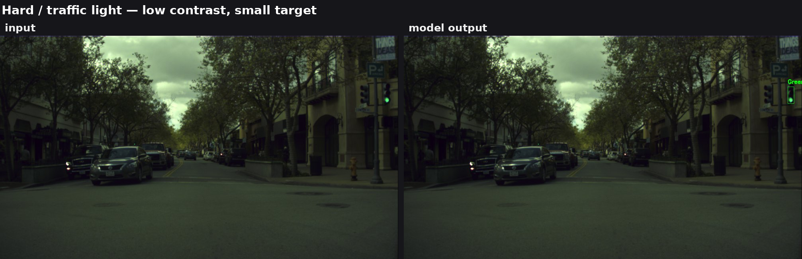
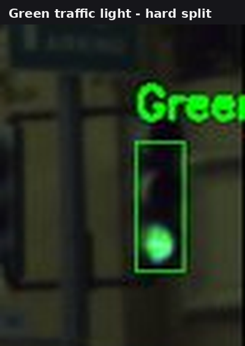
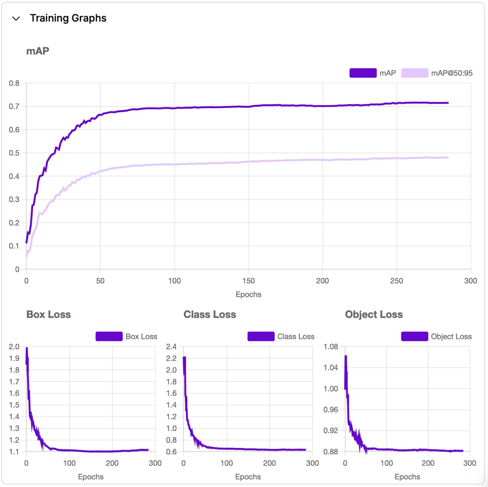
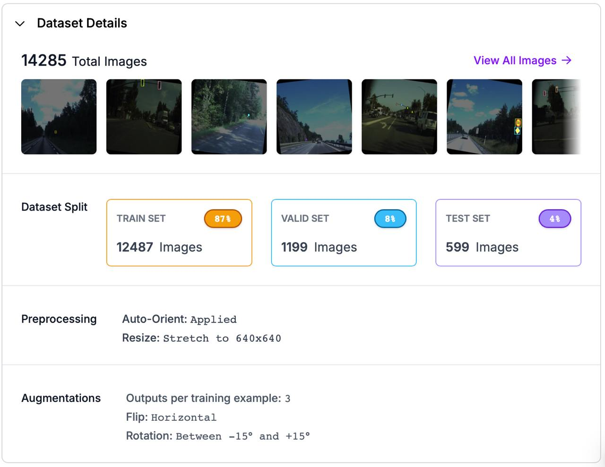

# Unified Traffic Sign and Traffic Light Detection

A single YOLO11 detector that recognises **20 traffic sign classes and 13 traffic
light states** in one forward pass, trained on a merged dataset built from two
independent public datasets that share nothing but the road scene.



---

## Overview

Driver-assistance and autonomous-driving stacks need to read two things off the
same frame: the signs that state a rule, and the lights that state permission. The
natural implementation is a single detection pass, because both are small,
high-contrast, geometrically regular objects sharing the same early visual cues —
edges, saturated colour, circular and rectangular structure.

The obstacle is not the model. It is the data. The public datasets for these two
tasks were built independently, by different groups, for different benchmarks, and
they agree on almost nothing:

| | Traffic signs | Traffic lights |
|---|---|---|
| Annotation storage | one file for the whole set | one file per frame |
| Coordinate convention | `[ulx, uly, lrx, lry]` | `x_min/x_max/y_min/y_max` |
| Native resolution | 1280 × 960 | 1280 × 720 |
| Object granularity | one sign = one object | one lamp, or a whole head, class-encoded |
| Label space | its own 20 names | its own 13 states |

Feeding them to a trainer as-is is impossible: YOLO wants normalised
`<class> <cx> <cy> <w> <h>` per box under a **single contiguous class index**.

**This project is the bridge.** Two format-specific converters normalise both sets
into YOLO's format, applying the geometric corrections each dataset needs, and a
frozen 33-class index fuses two unrelated label spaces into one. The result is a
model that reports `STOP` and `GreenStraight` from the same weights.

## Key features

- **Two dataset converters** — one per annotation format, each normalising to YOLO
  format and correcting the defects present in its source data.
- **A frozen 33-class unified index** (`src/classes.py`) — traffic signs 0–19,
  traffic light states 20–32, with the reverse map derived rather than duplicated.
- **Defensive parsing** — swapped box corners, boxes past the frame edge, and
  unmapped class labels are corrected or reported, never silently absorbed.
- **A merge stage** that de-collides filenames across datasets and emits a
  ready-to-train `data.yaml`.
- **Two training routes** — Roboflow-hosted or fully local from a `data.yaml`.
- **Two inference backends** — the hosted model, or a local `.pt` checkpoint.
- **Nine converter tests and thirteen static checks** runnable with no GPU, no
  dataset and no trained weights.

## Visual demonstrations

Every image below is real output. `samples/predictions/` holds the original
project's recorded detections; each input in `samples/inputs/` has a matching
prediction. Nothing here is a mock-up.

### Traffic sign — easy split





A `NO_PARKING` sign detected with a tight bounding box and the correct class. The
box tracks the sign disc closely — no over-extension into the surround.

### Traffic light — easy split





A lit `Green` signal on a gantry above an urban junction, detected alongside the
vehicle-mounted signal.

### Traffic light — hard split





The hard split is what the model is actually up against: a small, distant signal in
low-contrast, wet, high-traffic conditions. It is detected here as `Green`.

The samples also contain misses and at least one apparent false positive on a
vehicle body. They are left in rather than curated away — see
[Limitations](#limitations).

## Technical methodology

### Stage 1 — normalisation to YOLO format

YOLO requires, per box:

```
<class_index> <centre_x> <centre_y> <width> <height>
```

with the four geometry values divided by the image dimensions so they fall in
`[0, 1]`. Two converters are needed because the source formats are incompatible.

Three corrections are applied on load, and each one is load-bearing:

1. **Swapped corners.** At least one source annotation has `x_min > x_max` /
   `y_min > y_max`. Averaging the corners still yields the right centre, but the
   computed width comes out **negative** and the normalised label is unusable. The
   converter swaps the pair.
2. **Out-of-frame boxes.** At least one box extends past the right edge. Left
   unclipped, its normalised centre exceeds 1.0 and the sample trains as noise. The
   converter clamps to the frame.
3. **Correct normalisation basis.** Normalisation is valid only against the frame
   size the annotation was authored on. A wrong value silently scales every box in
   the set, with no error raised. Both converters therefore take the dimensions as
   arguments rather than assuming them.

The RIIB variant of the traffic light dataset is supported via `--riib`, which
additionally corrects its 8-pixel header offset.

### Stage 2 — the unified class index

The core artefact. Two unrelated taxonomies are placed in one 33-entry index:

- **0–19** — traffic signs (`STOP`, `GIVE_WAY`, `NO_PARKING`, the numeric speed
  signs, `PEDESTRIAN_CROSSING`, …)
- **20–32** — traffic light states (`Red`, `Yellow`, `Green`, plus the
  `Left`/`Right`/`Straight` variants that encode *which* lamp in a multi-lamp head
  is lit)

The numbering is **frozen**: it is baked into every generated label file and into
the trained model's output layer. `CLASS_NAMES` is derived from `CLASSES`
programmatically, which removes the class of bug where a forward and reverse map
drift apart.

A label that is not in the index is **skipped and reported**, never mapped to a
catch-all — a converter that guesses silently poisons the training set, and the
failure is invisible until evaluation.

### Stage 3 — merge

Image/label pairs from both converted trees are collected into one, with
filenames de-collided (two datasets can both contain `0001.jpg`, and a naive copy
silently loses one), and an Ultralytics `data.yaml` is emitted.

Images with no label file are copied as **backgrounds** with an empty `.txt`.
That is deliberate: YOLO uses them as negatives, which is what prevents a detector
from firing on empty road.

### Stage 4 — training

Fine-tuning from COCO-pretrained `yolo11n` (YOLO11 nano). The merged set was
uploaded to Roboflow, preprocessed and augmented there, and trained via a Google
Colab notebook — that run is where the working model came from.

Augmentation and preprocessing as recorded by the training platform:

| Setting | Value |
|---|---|
| Auto-orient | applied |
| Resize | stretch to 640 × 640 |
| Outputs per training example | 3 |
| Flip | horizontal |
| Rotation | −15° to +15° |

### Stage 5 — inference

Boxes are drawn as a 1 px green rectangle with the class name above it, matching
the original implementation so new output is directly comparable with the recorded
results in `samples/predictions/`.

## Architecture

```
   traffic signs (1280x960)              traffic lights (1280x720)
   images + annotations.txt              frames + per-frame YAML
              |                                     |
              v                                     v
    src/signs_to_yolo.py                  src/bstld_to_yolo.py
    parse records, skip MISC_SIGNS        parse YAML, fix corner order,
    emit normalised cls cx cy w h         clip to frame, emit normalised
              |                                     |
              +------------------+------------------+
                                 v
                    src/classes.py  (unified index)
                    signs 0-19  .  lights 20-32
                                 |
                                 v
                     src/merge_datasets.py
                     de-collide names . data.yaml
                                 |
                 +---------------+---------------+
                 v                               v
        src/train.py --route local     src/train.py --route roboflow
                 |                               |
                 +---------------+---------------+
                                 v
                          yolo11n fine-tune
                                 |
                                 v
                          src/predict.py
                  annotated frames written out
```

Full detail, including the design decisions and why the class index is not
reordered: [`docs/PIPELINE.md`](docs/PIPELINE.md).

## Repository structure

```
.
├── src/
│   ├── classes.py           unified 33-class index (the source of truth)
│   ├── bstld_to_yolo.py     traffic light YAML -> YOLO labels
│   ├── signs_to_yolo.py     traffic sign annotations.txt -> YOLO labels
│   ├── merge_datasets.py    merge converted sets, emit data.yaml
│   ├── train.py             fine-tune yolo11n
│   └── predict.py           run inference, draw boxes
├── tests/
│   └── test_converters.py   9 tests over the conversion arithmetic
├── tools/
│   └── static_checks.py     13 checks needing no GPU or dataset
├── samples/
│   ├── inputs/              held-out frames: easy/ and hard/
│   └── predictions/         the model's recorded output on those frames
├── docs/
│   ├── PIPELINE.md          module-by-module pipeline and rationale
│   ├── DATASETS.md          both datasets, their licences, the merge
│   ├── TEST_PLAN.md         what was verified, and what was not
│   ├── CHANGES.md           what changed from the original submission
│   ├── figures/             README and documentation figures
│   └── report/              the original project report (redacted)
├── requirements.txt
├── THIRD_PARTY_NOTICES.md
└── LICENSE
```

## Installation

Python 3.9+ (developed against 3.11 and 3.13).

```bash
git clone https://github.com/alishavakhi/traffic-sign-light-detection
cd traffic-sign-light-detection

python -m venv .venv
source .venv/bin/activate          # Windows: .venv\Scripts\activate

pip install -r requirements.txt
```

For the Roboflow routes only:

```bash
cp .env.example .env
# put your key in .env, then:
set -a; source .env; set +a
```

Get a key from <https://app.roboflow.com/> → Settings → API Keys. The key is read
from the `ROBOFLOW_API_KEY` environment variable and is never committed.

**No dataset and no trained checkpoint are included.** Both datasets are
third-party research data with their own terms — see
[`docs/DATASETS.md`](docs/DATASETS.md). The preview model is hosted on Roboflow.

## Running the project

### Check the environment without a GPU

```bash
python tools/static_checks.py        # 13 checks, exit 0 on success
python tests/test_converters.py      # 9 tests, no pytest required
```

### Convert and merge a dataset

```bash
# traffic lights: download BSTLD and accept its terms first
python -m src.bstld_to_yolo path/to/dataset_train_rgb/train.yaml
python -m src.bstld_to_yolo path/to/dataset_train_rgb/test.yaml

# traffic signs: point at the directory holding images + annotations.txt
python -m src.signs_to_yolo --dataset-root path/to/signs --width 1280 --height 960

# merge into one training set
python -m src.merge_datasets \
    --source lights=path/to/dataset_train_rgb \
    --source signs=path/to/signs \
    --output data/unified --val-fraction 0.08
```

### Train

```bash
# from a data.yaml you produced yourself — no account needed
python -m src.train --route local --data data/unified/data.yaml \
    --epochs 100 --imgsz 640

# or pull the dataset from the platform
python -m src.train --route roboflow --epochs 100 --imgsz 640
```

### Run inference

```bash
# local checkpoint
python -m src.predict --backend local \
    --weights runs/detect/train/weights/best.pt --split easy

# or the hosted model (needs ROBOFLOW_API_KEY)
python -m src.predict --backend roboflow --split easy
```

`--split hard` runs the hard set. `--input` / `--output` override the directories.

## Inputs and outputs

**Input** — an image file (`.jpg`, `.jpeg`, `.png`, `.bmp`). The recorded sets are
1280 × 960 (signs) and 1280 × 720 (lights) at native resolution; the model itself
takes any size.

**Output** — one annotated copy per input, same filename, same resolution, boxes
drawn in green with the class name above each box. Written to the output directory
and listed to stdout, with a per-image detection count:

```
rs2.jpg: 1 detection(s)
tl1.jpg: 2 detection(s)

19 image(s) processed, 31 detection(s) total
```

For the converters, the output is one `.txt` per image containing YOLO label lines.

## Results

### Detection

The recorded outputs in `samples/predictions/` are the original project's own
results, produced by querying the hosted model. Across the sets they show correct
detection of `NO_PARKING` signs and of `Green` traffic light states in both the
easy and the hard split — including the small, low-contrast, wet-weather case the
hard split exists to stress.

### Training

The training run recorded by the platform, read off
`docs/figures/roboflow_image1.png`:

| Series | At the end of the recorded run (~280 epochs) |
|---|---|
| mAP | ≈ 0.72 |
| mAP@50:95 | ≈ 0.48 |
| Box loss | 2.0 → ≈ 1.10 |
| Class loss | 2.2 → ≈ 0.60 |
| Object loss | 1.08 → ≈ 0.88 |



*Recorded by the training platform during the original run. The chart does not
label which split it was computed on — validation is the standard reading — and the
curves extend to ~280 epochs, more than this repository's 100-epoch default. These
figures were not measured on this machine.*

### Dataset

| | |
|---|---|
| Total images | 14,285 |
| Train | 12,487 (87%) |
| Validation | 1,199 (8%) |
| Test | 599 (4%) |



*The platform's dataset summary, as recorded in the original report.*

### Verified while preparing this repository

| Check | Result |
|---|---|
| `tools/static_checks.py` | 13 / 13 passing, exit 0 |
| `tests/test_converters.py` | 9 / 9 passing |
| Class index integrity | 33 classes, contiguous 0–32, round-trips, splits 20/13 |
| Recorded sample pairing | 19 / 19 predictions have a matching input |
| Documentation links | all relative links resolve |

**Not run here:** training, inference, and any accuracy measurement. This host has
no GPU, no dataset and no checkpoint. See
[`docs/TEST_PLAN.md`](docs/TEST_PLAN.md) for the full breakdown of what was
verified, what the original project demonstrated, and what remains unperformed.

## Limitations

1. **Small objects dominate the difficulty.** Traffic lights are roughly 10 px wide
   at 1280 × 720. It is why the hard split exists, and the recorded outputs show
   the failure mode.
2. **False positives on vehicle-mounted signals.** A signal attached to a car is
   geometrically and chromatically similar to a traffic light. At least one
   apparent false positive is visible in the recorded easy-split output.
3. **mAP ≈ 0.72 is not high enough for safety-critical use.** With 33 classes and
   small objects, this is a working detector, not a deployable one.
4. **The traffic sign dataset's provenance is unrecorded**, so its licence cannot
   be stated and its images are not redistributed beyond illustrative samples.
5. **No checkpoint is published.** Reproducing inference as-shipped needs a
   Roboflow account or your own training run.
6. **The training curve is not reproducible from the script defaults** — the
   recorded run used ~280 epochs; `src/train.py` defaults to 100.
7. **`ultralytics` is AGPL-3.0.** Relevant to any closed-source reuse — see
   [`THIRD_PARTY_NOTICES.md`](THIRD_PARTY_NOTICES.md) §3.

## Future improvements

Grounded in what the implementation actually lacks:

- **Publish a checkpoint** — as a release asset or via Git LFS — so inference is
  reproducible without a platform account.
- **Evaluate properly.** Compute mAP per class on the held-out test split (599
  images) and report where the 33 classes actually fail. The single aggregate
  figure hides a lot.
- **Treat signs and lights as separate heads** sharing a backbone, and measure
  whether the independence is worth the extra cost against the current single pass.
- **Add temporal smoothing for lights.** Frames are consecutive, and a light does
  not change state between them. A short track-level vote would remove most
  single-frame flicker without touching the detector.
- **Test-time augmentation or a larger input size** for the small-object case
  specifically, measured against the hard split.
- **Complete the attribution** in `THIRD_PARTY_NOTICES.md` §2 once the sign
  dataset's source is identified.

## My contribution

This repository presents a project by **Ali Shavakhi**, who designed and
implemented it:

- the two dataset converters, and the geometric corrections each required;
- the unified 33-class index that fuses the two label spaces;
- the dataset merge and preparation;
- the training configuration, preprocessing and augmentation choices;
- the inference and visualisation script;
- the project report under `docs/report/`.

The work done to prepare this repository — packaging, hardening the credential
handling, the tests and static checks, and the documentation — is described file
by file in [`docs/CHANGES.md`](docs/CHANGES.md). **No detection, conversion or
normalisation logic was altered.**

### Third-party components

- **`src/bstld_to_yolo.py` is derived from MIT-licensed sample code by Robert Bosch
  LLC and Karsten Behrendt**, from the Bosch Small Traffic Lights Dataset tooling.
  The parsing, corner-order correction and clipping logic are the original
  authors' work; the YOLO emission and CLI are added here. The MIT notice is
  retained in the module and reproduced in full in
  [`THIRD_PARTY_NOTICES.md`](THIRD_PARTY_NOTICES.md) §1.
- **Datasets are not redistributed.** They are third-party research datasets under
  their own terms — full detail in [`docs/DATASETS.md`](docs/DATASETS.md).
- **The sample frames** under `samples/` come from those datasets and are
  **excluded from this repository's licence**; they are included for
  non-commercial illustration only.
- **`ultralytics`** (AGPL-3.0), **OpenCV**, **PyYAML**, **NumPy** and the
  **Roboflow SDK** are runtime dependencies, not vendored here.

## Licence

The code in this repository is released under the **MIT Licence** — see
[`LICENSE`](LICENSE) — except where a file states otherwise. That exclusion covers
`src/bstld_to_yolo.py`, the sample images under `samples/`, and the third-party
dependencies.

Read [`THIRD_PARTY_NOTICES.md`](THIRD_PARTY_NOTICES.md) before reusing anything from
`samples/` or `docs/report/`.
